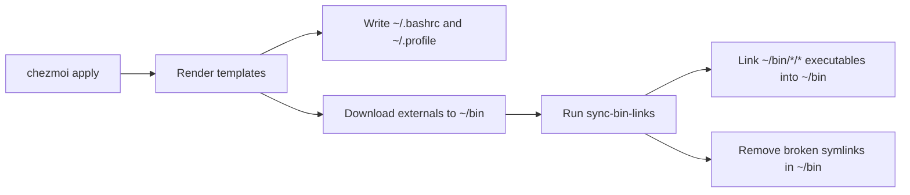

# Dotfiles

Personal dotfiles and user tool configuration managed with [chezmoi](https://www.chezmoi.io/).
The repository targets Linux and macOS on `amd64` and `arm64`.

## Architecture

Chezmoi renders templates, downloads external tools into `~/bin`, and runs `run_after_sync-bin-links.sh.tmpl` after each apply.



### Repository Layout

| Path | Target in `$HOME` | Purpose |
| --- | --- | --- |
| `.chezmoi.toml.tmpl` | `~/.config/chezmoi/chezmoi.toml` | Configures git automation and editor detection. |
| `.chezmoiexternal.toml.tmpl` | `~/bin/*` | Downloads external archives and binaries. |
| `.chezmoiignore` | Excluded | Keeps `README.md`, `LICENSE`, and `tests/` out of `$HOME`. |
| `dot_bashrc` | `~/.bashrc` | Loads `~/.profile` when `~/.profile` is readable. |
| `dot_profile` | `~/.profile` | Adds `~/bin` to `PATH`, defines a `realpath` fallback, and loads `~/.profile.d/*.sh`. |
| `run_after_sync-bin-links.sh.tmpl` | Run on apply | Links direct subdirectory executables into `~/bin` and removes broken symlinks. |
| `tests/` | Excluded | Runs static checks, shell tests, symlink tests, and template tests. |

### External Tools

| Target | Upstream Source | Platforms | Notes |
| --- | --- | --- | --- |
| `~/bin/bw_scripts` | `neoautomata/bw_scripts` | All | Clones the Git repository and links executables into `~/bin`. |
| `~/bin/bw.bin` | `bitwarden/clients` | Linux, macOS (`amd64`, `arm64`) | Matches the latest `cli-v*` release asset. |
| `~/bin/chezmoi` | `twpayne/chezmoi` | Linux, macOS (`amd64`, `arm64`) | Extracts `chezmoi` from the release tarball. |
| `~/bin/fzf` | `junegunn/fzf` | Linux, macOS (`amd64`, `arm64`) | Extracts `fzf` from the release tarball. |
| `~/bin/jj` | `jj-vcs/jj` | Linux, macOS (`amd64`, `arm64`) | Extracts `jj` from the release tarball. |
| `~/bin/massren` | `laurent22/massren` | Linux, macOS | Compiles from source with Go and CGo. |
| `~/bin/rg` | `BurntSushi/ripgrep` | Linux, macOS (`amd64`, `arm64`) | Extracts `rg` from the release tarball. |

## Prerequisites

Install these tools before bootstrapping:

- `chezmoi` (or `curl` and `sh` to install `chezmoi` during bootstrap)
- `bash` and a POSIX `sh`
- `git`
- `go`, `tar`, and a C compiler (`gcc` or `clang`) to build `massren`
- `perl` only on systems that lack a `realpath` binary

> [!NOTE]
> `dot_profile` runs in POSIX `sh` and Bash.
> `run_after_sync-bin-links.sh.tmpl` supports both GNU/Linux and macOS Bash 3.2.

## Bootstrap a New Machine

1. Install `chezmoi` and initialize this repository:

   ```sh
   sh -c "$(curl -fsLS get.chezmoi.io)" -- init --apply <github-username>
   ```

1. Open a new login shell or load `~/.profile` in the current shell:

   ```sh
   . "${HOME}/.profile"
   ```

## Update Dotfiles and External Tools

Run `chezmoi update` to pull repository changes and apply them:

```sh
chezmoi update
```

`bin/bw_scripts` uses a `24h` refresh period.
Versioned release entries cache immutable URLs until a new release appears.
Pass `-R` to force an immediate refresh of all external entries:

```sh
chezmoi apply -R
```

## Common Commands

| Task | Command |
| --- | --- |
| Preview pending changes | `chezmoi diff` |
| Apply changes | `chezmoi apply` |
| Refresh external tools now | `chezmoi apply -R` |
| Edit a managed dotfile | `chezmoi edit ~/.profile` |
| List managed files | `chezmoi managed` |
| Run the test suite | `./tests/run_tests.sh` |

<details>
<summary>Add interactive shell hooks in <code>~/.profile.d</code></summary>

Create readable `*.sh` files under `~/.profile.d`:

```sh
mkdir -p "${HOME}/.profile.d"
printf '%s\n' 'alias ll="ls -la"' > "${HOME}/.profile.d/10-aliases.sh"
```

`~/.profile` loads these files only in interactive shells when `PROGNAME` is unset.
Non-interactive login shells still receive `~/bin` in `PATH`.

Set `PROFILE_DEBUG=1` to print debug messages to `stderr` while loading `~/.profile`.

</details>

<details>
<summary>Manage local tools under <code>~/bin</code></summary>

`run_after_sync-bin-links.sh.tmpl` scans executable files at depth two (`~/bin/<subdir>/<file>`).

- The script skips hidden files, hidden directories, and `install.sh` scripts.
- The script preserves existing regular files and valid symlinks in `~/bin`.
- The script removes broken symlinks in `~/bin` or replaces them when a matching executable exists.
- Duplicate basenames across subdirectories emit a warning to `stderr` and keep the first match.

</details>

## Configuration and Security Notes

> [!IMPORTANT]
> `.chezmoi.toml.tmpl` enables `git.autoCommit = true` and `git.autoPush = true`.
> Any change applied through `chezmoi edit` or `chezmoi add` commits and pushes to the remote repository automatically.

- **Editor detection:** `.chezmoi.toml.tmpl` sets `subl --wait` as the editor when `subl` is in `PATH`.
  When `subl` is absent, chezmoi omits `[edit]` and uses `$VISUAL`, `$EDITOR`, or `vi`.
- **External binary sources:** `.chezmoiexternal.toml.tmpl` downloads binaries over HTTPS from upstream GitHub releases.
  Unsupported OS or CPU architectures omit incompatible external entries instead of emitting invalid URLs.
- **Build isolation:** The `massren` filter checks for `go`, `tar`, and a C compiler.
  It compiles in a temporary directory and removes that directory on `EXIT`, `INT`, `TERM`, and `HUP`.

> [!WARNING]
> Do not store private keys, tokens, or unencrypted secrets inside `~/.profile.d` files that you add to chezmoi.
> Use a password manager or chezmoi encryption for sensitive values.

## Testing

Run the full test suite from the repository root:

```sh
./tests/run_tests.sh
```

The runner executes four suites:

1. `tests/test_lint.sh` checks shell syntax, `shellcheck`, and `mdformat`.
1. `tests/test_shell_init.sh` verifies `dot_bashrc`, `dot_profile`, `PATH` deduplication, `~/.profile.d` hooks, and the `realpath` fallback.
1. `tests/test_sync_bin_links.sh` verifies symlink creation, collision warnings, preservation of regular files and valid symlinks, broken symlink removal, and idempotency.
1. `tests/test_chezmoi_templates.sh` renders templates across Linux, macOS, and Windows mock data, checks TOML with Python `tomllib`, checks `.chezmoiignore`, and checks the `massren` filter.
